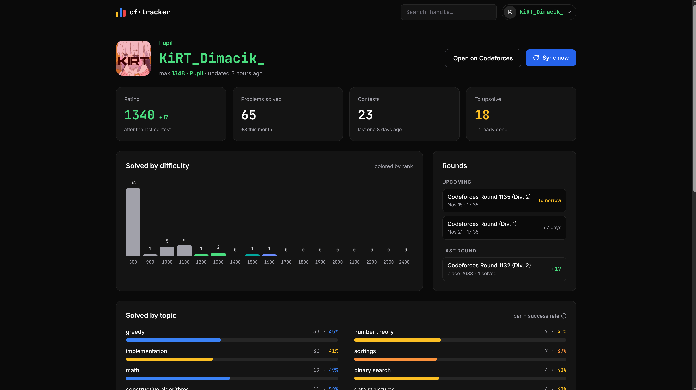
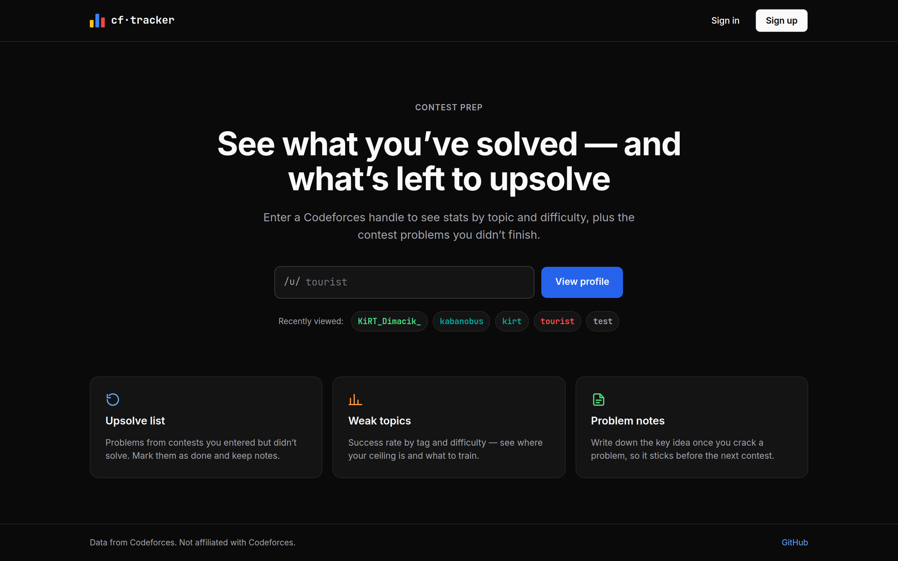
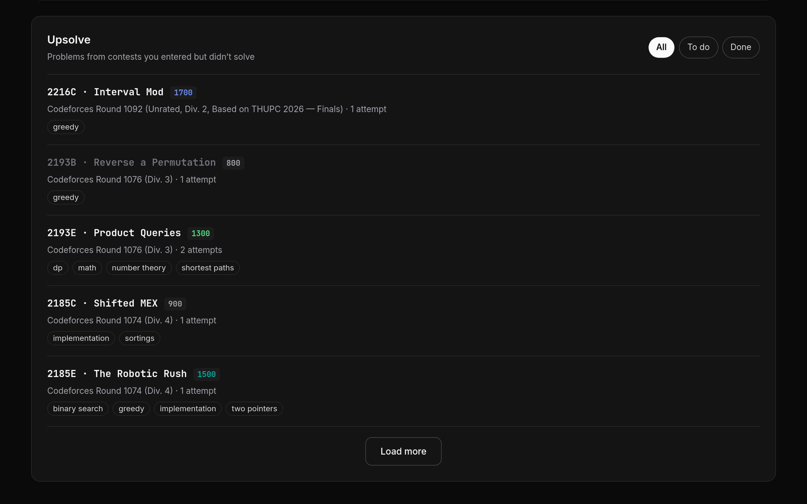
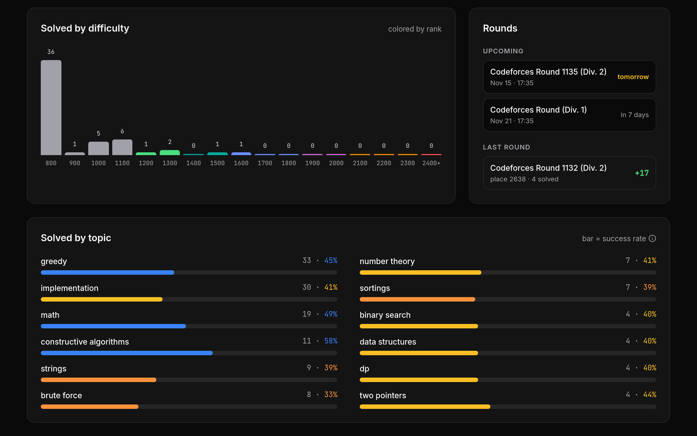
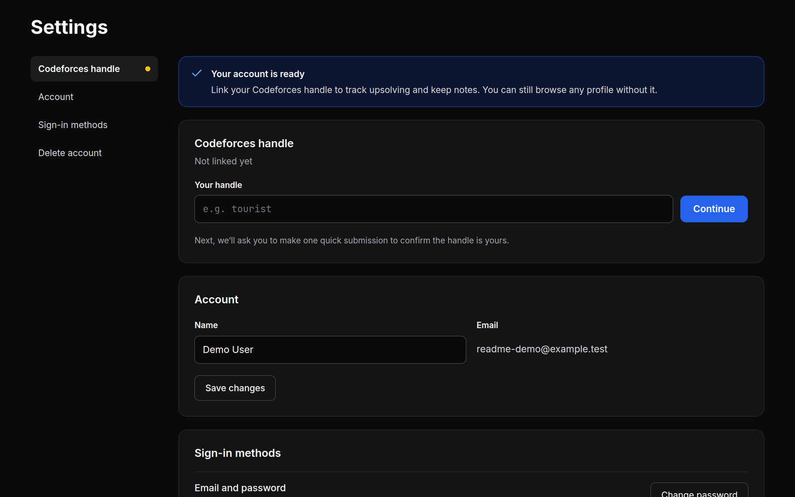
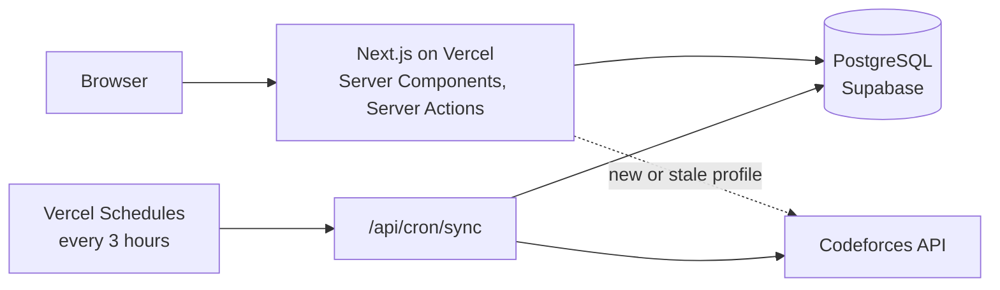

# cf·tracker

<h1 align="center">cf·tracker</h1>

<p align="center">
  Contest-prep dashboard on top of Codeforces data: see what you've solved,
  where you're weak, and which contest problems are still left to upsolve.
</p>

<p align="center">
  <a href="https://kirt08-cftracker.vercel.app"><b>Live demo</b></a>
  ·
  <a href="https://kirt08-cftracker.vercel.app/u/tourist"><b>Try without signing up</b></a>
</p>

<p align="center">
  
</p>

## About

After a Codeforces round, the problems you didn't finish are easy to forget. kirt08-cftracker pulls your submissions from the Codeforces API, builds an upsolve list from the contests you took part in, and shows your stats by topic and difficulty, so you know what to train before the next round.

Any public handle can be viewed without an account. Signing up and linking your own handle adds notes, manual "done" marks and on-demand sync.

## Features

- **Profile** for any Codeforces handle: rating, problems solved, contests, problems left to upsolve, upcoming rounds and your last round.
- **Upsolve list**: problems you attempted during a contest but didn't solve. They are marked done automatically once you get Accepted later, or manually. Filters All / To do / Done.
- **Problem notes**: write down the key idea for each upsolve problem. Notes are visible only to you.
- **Weak topics**: success rate by tag (accepted / all submissions), highlighted by thresholds.
- **Solved by difficulty**: a chart of solved problems from 800 to 2400+.
- **Handle verification**: prove you own a handle by submitting a compilation error to a given problem within 5 minutes.
- **Automatic sync**: linked handles refresh every 3 hours; other profiles refresh in the background when someone opens them.
- **Accounts**: email + password or GitHub; change name, set or change password, connect GitHub, delete account.
- **Recently viewed** handles on the home page.

## Screenshots

<table>
  <tr>
    <td width="50%" align="center">
      <a href="screenshots/home.png"></a>
      <br><sub>Home: search and recently viewed handles</sub>
    </td>
    <td width="50%" align="center">
      <a href="screenshots/upsolve.png"></a>
      <br><sub>Upsolve list with filters and notes</sub>
    </td>
  </tr>
  <tr>
    <td width="50%" align="center">
      <a href="screenshots/topics.png"></a>
      <br><sub>Solved by difficulty and weak topics</sub>
    </td>
    <td width="50%" align="center">
      <a href="screenshots/settings.png"></a>
      <br><sub>Settings: handle verification and sign-in methods</sub>
    </td>
  </tr>
</table>

## Tech stack

| Area | Technology |
| --- | --- |
| Framework | Next.js 16 (App Router, Cache Components, React Compiler), React 19 |
| Language | TypeScript |
| Styling | Tailwind CSS, shadcn/ui on Base UI |
| Database | PostgreSQL on Supabase |
| ORM | Drizzle ORM + postgres.js |
| Auth | Better Auth |
| Hosting | Vercel (Functions in `dub1`, next to the DB in eu-west-1) |
| Jobs | Vercel Schedules |
| CI | GitHub Actions |


## Lines of code

Language|files|blank|comment|code
:-------|-------:|-------:|-------:|-------:
TypeScript|79|643|2|5441
CSS|1|6|0|115
YAML|1|7|0|44
JavaScript|1|2|2|14
--------|--------|--------|--------|--------
SUM:|82|658|4|5614

## Architecture



Pages always read from our own database, so a Codeforces outage doesn't break them. Codeforces is called only to load a new handle, refresh a stale one, or run the scheduled sync.

## Engineering highlights

- **Codeforces sync.** The API allows about one request every 2 seconds, so requests go through a queue with that interval. Submissions load incrementally: pages stop at the newest stored ID. Writes run in a single transaction. A `sync_status` lock with a stale-lock timeout prevents parallel syncs of one handle.
- **Idempotent cron.** Vercel delivers scheduled runs best-effort, with no retries and possible duplicates. The job skips handles synced in the last 2 hours, stops starting new work after a 230 s budget (the function limit is 300 s), and stops early after 3 "Codeforces unavailable" results in a row. Each step fails independently and the run returns a JSON summary.
- **Background refresh.** Profiles without an owner are served from the DB immediately; if the data is older than 6 hours, a sync runs in `after()` once the response is sent.
- **Upsolve rule in SQL.** A problem is in the list if the user submitted during the contest and none of those submissions was accepted. Status is computed on read, with no stored flag to go stale. Pagination is keyset (`start_time, contest_id, index`), so marking a row done doesn't shift the next page.
- **Handle ownership.** The race for one handle is resolved by a conditional `UPDATE ... WHERE owner_user_id IS NULL`; only the first request wins.
- **Security.** `proxy.ts` only does an optimistic cookie check; every page and Server Action re-checks the session and ownership. GitHub sign-in won't attach to an existing email + password account (pre-account takeover protection); linking happens from Settings while signed in. The cron endpoint requires `Authorization: Bearer <CRON_SECRET>`.

## Getting started

Requirements: Node.js (see `package.json`), a PostgreSQL database, and a GitHub OAuth App for GitHub sign-in.

```bash
git clone https://github.com/kirt08/kirt08-CFtracker.git
cd kirt08-CFtracker
npm ci
cp .env.example .env.local
```

Fill in `.env.local`:

| Variable | Purpose |
| --- | --- |
| `DATABASE_URL` | Runtime connection (Supabase pooler, port 6543) |
| `MIGRATION_DATABASE_URL` | Connection used by `drizzle-kit` for migrations |
| `BETTER_AUTH_SECRET` | Secret for signing sessions |
| `GITHUB_CLIENT_ID`, `GITHUB_CLIENT_SECRET` | GitHub OAuth App, callback `http://localhost:3000/api/auth/callback/github` |
| `CRON_SECRET` | Bearer token for `/api/cron/sync` |

Apply migrations and start the dev server:

```bash
npx drizzle-kit migrate
npm run dev
```

The app runs on http://localhost:3000. To run the sync job locally:

```bash
curl -H "Authorization: Bearer $CRON_SECRET" http://localhost:3000/api/cron/sync
```

Checks used in CI: `npm run lint`, `npm run typecheck`, `npm run build`.

## Project structure

```text
src/
  app/            routes: home, login, signup, settings, u/[handle], api/auth, api/cron/sync
  components/     UI by feature: header, home, profile, settings, auth, ui (shadcn)
  db/             Drizzle schema (Better Auth tables + app tables)
  lib/            Codeforces client, sync, queries, auth, session helpers
  proxy.ts        optimistic redirect from /settings for signed-out users
drizzle/          SQL migrations
```

## Workflow

- Feature branches → `dev` → `main`; CI rejects PRs into `main` from any branch other than `dev`.
- `main` deploys to production on Vercel; PRs get preview deployments.

## Limitations and roadmap

- No password reset or email verification yet (needs an email service).
- The upsolve list shows the number of attempts, not the verdict (would need a new column and a full resync).
- GitHub can be connected but not disconnected from Settings.
- The header takes three rows on narrow phones.

## Disclaimer

Data comes from the [Codeforces API](https://codeforces.com/apiHelp). This project is not affiliated with Codeforces.
